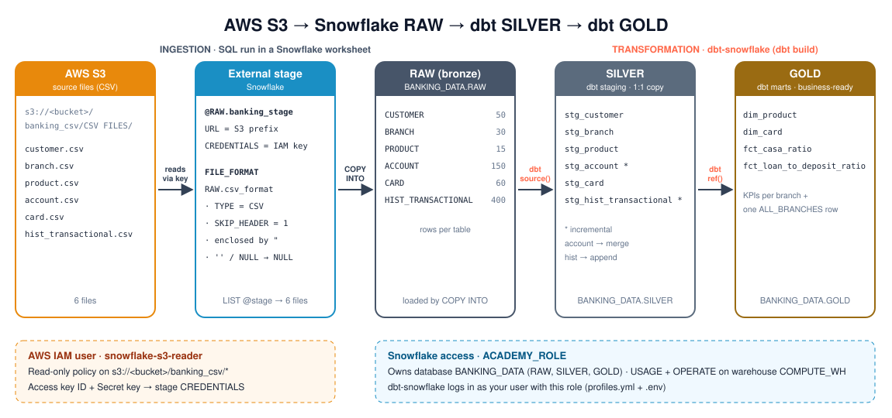
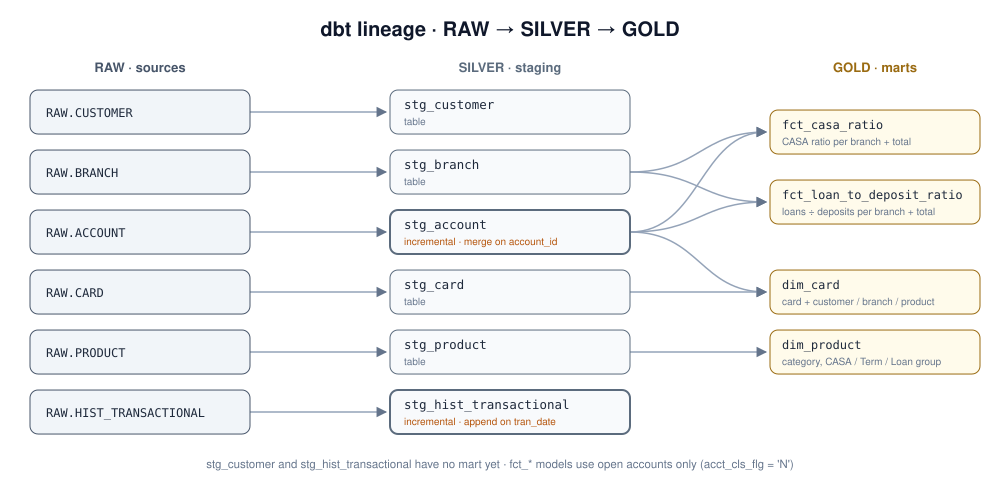

# Banking Data Pipeline: AWS S3 → Snowflake → dbt

This project builds a small banking data warehouse in three layers:

| Layer | Snowflake schema | Built by | What it holds |
|---|---|---|---|
| **RAW** (bronze) | `BANKING_DATA.RAW` | `COPY INTO` from an S3 stage | The six CSV files, loaded as-is |
| **SILVER** | `BANKING_DATA.SILVER` | dbt staging models | One clean `stg_*` table per raw table |
| **GOLD** | `BANKING_DATA.GOLD` | dbt mart models | Dimensions and KPI facts (CASA ratio, loan-to-deposit ratio) |



**How the data moves**

1. The CSV files sit in an S3 bucket under `banking_csv/CSV FILES/`.
2. An **AWS IAM user** with read-only access to that folder gives Snowflake an *access key ID* and *secret access key*.
3. In Snowflake, an **external stage** (`RAW.banking_stage`) points at the S3 folder using that key. A **file format** (`RAW.csv_format`) tells Snowflake how to read the CSVs.
4. `COPY INTO` loads each file into its table in the `RAW` schema.
5. **dbt-snowflake** reads the RAW tables with `source()`, builds the SILVER staging tables, and then builds the GOLD marts from SILVER with `ref()`.

---

## Contents

1. [Prerequisites](#1-prerequisites)
2. [AWS: create the S3 bucket and upload the CSVs](#2-aws-create-the-s3-bucket-and-upload-the-csvs)
3. [AWS: create an IAM user, access key and secret key](#3-aws-create-an-iam-user-access-key-and-secret-key)
4. [Snowflake: create the role, database and schema](#4-snowflake-create-the-role-database-and-schema)
5. [Snowflake: create RAW tables and load them from S3](#5-snowflake-create-raw-tables-and-load-them-from-s3)
6. [dbt: set up the dbt-snowflake project](#6-dbt-set-up-the-dbt-snowflake-project)
7. [dbt: the models (SILVER and GOLD)](#7-dbt-the-models-silver-and-gold)
8. [Run and test](#8-run-and-test)
9. [Troubleshooting](#9-troubleshooting)
10. [Security checklist](#10-security-checklist)

Throughout this guide, replace the placeholders with your own values:

| Placeholder | Example | Where you get it |
|---|---|---|
| `<YOUR_SNOWFLAKE_USERNAME>` | `JOHNDOE` | Snowflake → your profile (top left) |
| `<YOUR_SNOWFLAKE_ACCOUNT>` | `ab12345.ap-south-1.aws` | Snowflake → Admin → Accounts → *Locator* + region |
| `<YOUR_BUCKET_NAME>` | `my-banking-bucket` | The S3 bucket you create in step 2 |
| `<YOUR_AWS_ACCESS_KEY_ID>` | `AKIA................` | IAM user's access key (step 3) |
| `<YOUR_AWS_SECRET_ACCESS_KEY>` | `wJalr....................` | IAM user's secret key (step 3), shown **once** |

---

## 1. Prerequisites

- An **AWS account** that can create S3 buckets and IAM users.
- A **Snowflake account** and a user that can switch to `ACCOUNTADMIN` (needed once, to create the role and database).
- **Python 3.9+** on your machine.
- The six CSV files: `customer.csv`, `branch.csv`, `product.csv`, `account.csv`, `card.csv`, `hist_transactional.csv`.

---

## 2. AWS: create the S3 bucket and upload the CSVs

1. Open the AWS Console → **S3** → **Create bucket**.
2. **Bucket name:** `<YOUR_BUCKET_NAME>` (must be globally unique).
   **Region:** pick the **same region as your Snowflake account** (for example `ap-south-1`). That keeps loads fast and avoids cross-region transfer charges.
3. Leave **Block all public access** turned **on**. Snowflake reads the bucket with a key, so it never needs to be public.
4. Click **Create bucket**.
5. Open the bucket → **Create folder** → name it `banking_csv`.
6. Open `banking_csv/` → **Upload** → **Add folder** → choose your local `CSV FILES` folder → **Upload**.

The result should look like this:

```
s3://<YOUR_BUCKET_NAME>/banking_csv/CSV FILES/account.csv
s3://<YOUR_BUCKET_NAME>/banking_csv/CSV FILES/branch.csv
s3://<YOUR_BUCKET_NAME>/banking_csv/CSV FILES/card.csv
s3://<YOUR_BUCKET_NAME>/banking_csv/CSV FILES/customer.csv
s3://<YOUR_BUCKET_NAME>/banking_csv/CSV FILES/hist_transactional.csv
s3://<YOUR_BUCKET_NAME>/banking_csv/CSV FILES/product.csv
```

> The folder name `CSV FILES` contains a space. That is why the `COPY INTO` statements in step 5 quote the path as `'CSV FILES/customer.csv'`.

---

## 3. AWS: create an IAM user, access key and secret key

Snowflake needs credentials to read the bucket. Create a dedicated IAM user that can **only read** the `banking_csv/` folder. Don't use your root account or your personal admin user's keys.

### 3.1 Create a read-only policy

1. AWS Console → **IAM** → **Policies** → **Create policy** → **JSON** tab.
2. Paste this policy, replacing `<YOUR_BUCKET_NAME>`:

```json
{
  "Version": "2012-10-17",
  "Statement": [
    {
      "Sid": "ListBankingFolder",
      "Effect": "Allow",
      "Action": ["s3:ListBucket", "s3:GetBucketLocation"],
      "Resource": "arn:aws:s3:::<YOUR_BUCKET_NAME>",
      "Condition": {
        "StringLike": { "s3:prefix": ["banking_csv/", "banking_csv/*"] }
      }
    },
    {
      "Sid": "ReadBankingFiles",
      "Effect": "Allow",
      "Action": ["s3:GetObject", "s3:GetObjectVersion"],
      "Resource": "arn:aws:s3:::<YOUR_BUCKET_NAME>/banking_csv/*"
    }
  ]
}
```

3. **Next** → name it `snowflake-banking-read` → **Create policy**.

### 3.2 Create the IAM user

1. **IAM** → **Users** → **Create user**.
2. **User name:** `snowflake-s3-reader`. Leave **Provide user access to the AWS Management Console** **unchecked**. This user is for programs, not people.
3. **Next** → **Attach policies directly** → search for `snowflake-banking-read` → tick it → **Next** → **Create user**.

### 3.3 Create the access key and secret key

1. Open the user `snowflake-s3-reader` → **Security credentials** tab.
2. Under **Access keys**, click **Create access key**.
3. **Use case:** choose **Third-party service** (or *Application running outside AWS*). Tick the confirmation box → **Next**.
4. (Optional) Add a description tag such as `snowflake banking stage` → **Create access key**.
5. You now see:
   - **Access key ID**: this is `<YOUR_AWS_ACCESS_KEY_ID>`
   - **Secret access key**: this is `<YOUR_AWS_SECRET_ACCESS_KEY>`

   Click **Download .csv file** and store it somewhere safe, such as a password manager. **The secret key is shown only once.** If you lose it, deactivate the key and create a new one.

> **Never** commit these keys to Git, paste them into a README, or share them in chat. If a key is ever exposed, go to **Security credentials → Access keys → Actions → Deactivate**, then delete it and create a new one.

---

## 4. Snowflake: create the role, database and schema

Run this once in a Snowflake worksheet. It creates a project role, `ACADEMY_ROLE`, and makes it the **owner** of the `BANKING_DATA` database. dbt runs with this role, so it can create the `SILVER` and `GOLD` schemas by itself.

```sql
USE ROLE ACCOUNTADMIN;

-- 1. Create the role (skipped if it already exists)
CREATE ROLE IF NOT EXISTS ACADEMY_ROLE;

-- 2. Put it in the role hierarchy and give it to your user
GRANT ROLE ACADEMY_ROLE TO ROLE SYSADMIN;
GRANT ROLE ACADEMY_ROLE TO USER <YOUR_SNOWFLAKE_USERNAME>;

-- 3. Let it use the existing COMPUTE_WH warehouse
GRANT USAGE, OPERATE ON WAREHOUSE COMPUTE_WH TO ROLE ACADEMY_ROLE;

-- 4. Database + RAW schema
CREATE DATABASE IF NOT EXISTS BANKING_DATA;
CREATE SCHEMA  IF NOT EXISTS BANKING_DATA.RAW;

-- 5. Make ACADEMY_ROLE the owner, so dbt can create SILVER / GOLD
GRANT OWNERSHIP ON DATABASE BANKING_DATA   TO ROLE ACADEMY_ROLE COPY CURRENT GRANTS;
GRANT OWNERSHIP ON SCHEMA BANKING_DATA.RAW TO ROLE ACADEMY_ROLE COPY CURRENT GRANTS;

-- 6. Object privileges inside RAW (already covered by ownership, safe to run)
GRANT CREATE TABLE, CREATE STAGE, CREATE FILE FORMAT
  ON SCHEMA BANKING_DATA.RAW TO ROLE ACADEMY_ROLE;
```

What each grant is for:

| Grant | Why it's needed |
|---|---|
| `GRANT ROLE ACADEMY_ROLE TO ROLE SYSADMIN` | Lets admins see and manage objects this role creates. This is Snowflake's recommended hierarchy. |
| `GRANT ROLE ... TO USER` | Lets **your** user switch to the role (`USE ROLE ACADEMY_ROLE`). dbt logs in as this user. |
| `USAGE, OPERATE ON WAREHOUSE` | Lets the role run queries and resume the warehouse when it's suspended. |
| `OWNERSHIP ON DATABASE` | Lets dbt run `CREATE SCHEMA SILVER` / `GOLD` and create tables in them. |
| `OWNERSHIP ON SCHEMA RAW` | Lets the role create the raw tables, file format and stage. |

Check it worked:

```sql
SHOW GRANTS TO ROLE ACADEMY_ROLE;
SHOW GRANTS TO USER <YOUR_SNOWFLAKE_USERNAME>;
```

---

## 5. Snowflake: create RAW tables and load them from S3

Switch to the project role and run the rest of the load script.

### 5.1 Context

```sql
USE ROLE ACADEMY_ROLE;
USE WAREHOUSE COMPUTE_WH;
USE DATABASE BANKING_DATA;
USE SCHEMA RAW;
```

### 5.2 RAW tables

```sql
CREATE OR REPLACE TABLE BANKING_DATA.RAW.CUSTOMER (
    cust_id STRING,
    name STRING,
    address STRING,
    phone_number STRING,
    postal_code STRING,
    country STRING,
    email STRING,
    father_name STRING,
    mother_name STRING,
    occupation STRING,
    education STRING,
    nationality STRING,
    PRIMARY KEY (cust_id)
);

CREATE OR REPLACE TABLE BANKING_DATA.RAW.BRANCH (
    branch_id STRING,
    province STRING,
    cluster_name STRING,
    city_name STRING,
    branch_name STRING,
    PRIMARY KEY (branch_id)
);

CREATE OR REPLACE TABLE BANKING_DATA.RAW.PRODUCT (
    product_id STRING,
    schm_type STRING,
    schm_code STRING,
    product_desc STRING,
    PRIMARY KEY (product_id)
);

CREATE OR REPLACE TABLE BANKING_DATA.RAW.ACCOUNT (
    account_id STRING,
    customer_id STRING,
    branch_id STRING,
    account_balance NUMBER(15,2),
    lien_amt NUMBER(15,2),
    acct_cls_flg STRING,
    product_id STRING,
    schm_type STRING,
    schm_code STRING,
    acct_crncy_code STRING,
    lchg_time TIMESTAMP,
    PRIMARY KEY (account_id)
);

CREATE OR REPLACE TABLE BANKING_DATA.RAW.CARD (
    card_number STRING,
    account_id STRING,
    balance NUMBER(15,2),
    card_type STRING,
    closing_balance NUMBER(15,2),
    card_expiry_date DATE,
    PRIMARY KEY (card_number)
);

CREATE OR REPLACE TABLE BANKING_DATA.RAW.HIST_TRANSACTIONAL (
    tran_id STRING,
    account_id STRING,
    branch_id STRING,
    tran_amount NUMBER(15,2),
    tran_crncy STRING,
    tran_date DATE,
    tran_particular STRING,
    tran_remarks STRING,
    created_date TIMESTAMP,
    modified_date TIMESTAMP,
    PRIMARY KEY (tran_id)
);
```

> Snowflake records `PRIMARY KEY` but does **not enforce** it. Uniqueness is checked later by the dbt `unique` tests.

### 5.3 File format

```sql
CREATE FILE FORMAT IF NOT EXISTS BANKING_DATA.RAW.csv_format
  TYPE = 'CSV'
  FIELD_DELIMITER = ','
  SKIP_HEADER = 1                         -- first row is the header
  FIELD_OPTIONALLY_ENCLOSED_BY = '"'      -- customer.address has commas inside quotes
  NULL_IF = ('', 'NULL')                  -- card.closing_balance is empty for DEBIT cards
  ERROR_ON_COLUMN_COUNT_MISMATCH = FALSE;

SHOW FILE FORMATS;
```

### 5.4 External stage (this is where the AWS keys go)

```sql
CREATE OR REPLACE STAGE BANKING_DATA.RAW.banking_stage
  FILE_FORMAT = BANKING_DATA.RAW.csv_format
  URL = 's3://<YOUR_BUCKET_NAME>/banking_csv/'
  CREDENTIALS = (
      aws_key_id     = '<YOUR_AWS_ACCESS_KEY_ID>',
      aws_secret_key = '<YOUR_AWS_SECRET_ACCESS_KEY>'
  );

SHOW STAGES;
LIST @BANKING_DATA.RAW.banking_stage;     -- must show the 6 CSV files
```

Type the real keys **only in the Snowflake worksheet**. Don't save them in any file in this repo. Once the stage exists, Snowflake keeps the credentials, so you won't need them again.

> **Better for production:** use a [storage integration](https://docs.snowflake.com/en/user-guide/data-load-s3-config-storage-integration) (an IAM *role* that Snowflake assumes) instead of a long-lived access key. The stage then uses `STORAGE_INTEGRATION = ...` and no secret is stored anywhere.

### 5.5 Load with COPY INTO

```sql
COPY INTO BANKING_DATA.RAW.CUSTOMER
FROM @BANKING_DATA.RAW.banking_stage
FILES = ('CSV FILES/customer.csv');

COPY INTO BANKING_DATA.RAW.BRANCH
FROM @BANKING_DATA.RAW.banking_stage
FILES = ('CSV FILES/branch.csv');

COPY INTO BANKING_DATA.RAW.PRODUCT
FROM @BANKING_DATA.RAW.banking_stage
FILES = ('CSV FILES/product.csv');

COPY INTO BANKING_DATA.RAW.ACCOUNT
FROM @BANKING_DATA.RAW.banking_stage
FILES = ('CSV FILES/account.csv');

COPY INTO BANKING_DATA.RAW.CARD
FROM @BANKING_DATA.RAW.banking_stage
FILES = ('CSV FILES/card.csv');

COPY INTO BANKING_DATA.RAW.HIST_TRANSACTIONAL
FROM @BANKING_DATA.RAW.banking_stage
FILES = ('CSV FILES/hist_transactional.csv');
```

### 5.6 Verify

```sql
SELECT 'customer' AS tbl, COUNT(*) AS cnt FROM BANKING_DATA.RAW.CUSTOMER
UNION ALL SELECT 'branch',             COUNT(*) FROM BANKING_DATA.RAW.BRANCH
UNION ALL SELECT 'product',            COUNT(*) FROM BANKING_DATA.RAW.PRODUCT
UNION ALL SELECT 'account',            COUNT(*) FROM BANKING_DATA.RAW.ACCOUNT
UNION ALL SELECT 'card',               COUNT(*) FROM BANKING_DATA.RAW.CARD
UNION ALL SELECT 'hist_transactional', COUNT(*) FROM BANKING_DATA.RAW.HIST_TRANSACTIONAL;
```

Expected counts: **customer 50 · branch 30 · product 15 · account 150 · card 60 · hist_transactional 400**.

> `COPY INTO` remembers which files it has already loaded (for 64 days), so running it again won't create duplicates. To force a reload, add `FORCE = TRUE`.

---

## 6. dbt: set up the dbt-snowflake project

### 6.1 Install dbt-snowflake

```bash
python3 -m venv venv
source venv/bin/activate          # Windows: venv\Scripts\activate
pip install --upgrade pip
pip install dbt-core dbt-snowflake
dbt --version                     # should list the "snowflake" plugin
```

### 6.2 Create the project (only when starting from scratch)

```bash
dbt init snowflow_proj            # choose "snowflake" when asked for the adapter
cd snowflow_proj
```

If you cloned this repo, skip `dbt init`. The project already exists.

### 6.3 Connection: `profiles.yml` + `.env`

`profiles.yml` lives in the project folder and reads the secrets from environment variables:

```yaml
snowflow_proj:
  target: snowflake
  outputs:
    snowflake:
      type: snowflake
      account: "{{ env_var('SNOWFLAKE_ACCOUNT') }}"     # e.g. ab12345.ap-south-1.aws
      user: "{{ env_var('SNOWFLAKE_USER') }}"
      password: "{{ env_var('SNOWFLAKE_PASSWORD') }}"
      role: ACADEMY_ROLE
      warehouse: COMPUTE_WH
      database: BANKING_DATA
      schema: RAW
      threads: 4
```

Create a `.env` file in the project folder. It is listed in `.gitignore`, so Git ignores it:

```bash
SNOWFLAKE_ACCOUNT=<YOUR_SNOWFLAKE_ACCOUNT>
SNOWFLAKE_USER=<YOUR_SNOWFLAKE_USERNAME>
SNOWFLAKE_PASSWORD=<YOUR_SNOWFLAKE_PASSWORD>
```

Load it into your shell and test the connection:

```bash
set -a; source .env; set +a
dbt debug --profiles-dir .        # every check should say "OK"
```

> Tip: `export DBT_PROFILES_DIR=.` lets you drop `--profiles-dir .` from every command.

### 6.4 Layers and schemas: `dbt_project.yml`

```yaml
models:
  snowflow_proj:
    staging:                 # models/staging/*  -> BANKING_DATA.SILVER
      +schema: silver
      +materialized: table
    marts:                   # models/marts/*    -> BANKING_DATA.GOLD
      +schema: gold
      +materialized: table
```

### 6.5 Schema naming: `macros/generate_schema_name.sql`

By default dbt *joins* the target schema and the custom schema, which would produce `RAW_SILVER` and `RAW_GOLD`. This macro overrides that, so the schemas are named exactly `SILVER` and `GOLD`:

```sql

    
        {{ target.schema }}
    
        {{ custom_schema_name | trim }}
    

```

### 6.6 Sources: `models/sources.yml`

This file tells dbt where the RAW tables are. Models then read them with `{{ source('RAW', 'CUSTOMER') }}`.

```yaml
sources:
  - name: RAW
    database: BANKING_DATA
    schema: RAW
    tables:
      - name: CUSTOMER
      - name: BRANCH
      - name: PRODUCT
      - name: ACCOUNT
      - name: CARD
      - name: HIST_TRANSACTIONAL
```

### 6.7 Project layout

```
snowflow_proj/
├── dbt_project.yml
├── profiles.yml              # connection (reads secrets from env vars)
├── .env                      # your secrets (git-ignored)
├── macros/
│   └── generate_schema_name.sql
├── models/
│   ├── sources.yml           # RAW tables
│   ├── staging/              # -> SILVER
│   │   ├── stg_customer.sql / .yml
│   │   ├── stg_branch.sql   / .yml
│   │   ├── stg_product.sql  / .yml
│   │   ├── stg_account.sql  / .yml   (incremental, merge)
│   │   ├── stg_card.sql     / .yml
│   │   └── stg_hist_transactional.sql / .yml   (incremental, append)
│   └── marts/                # -> GOLD
│       ├── dim_product.sql / .yml
│       ├── dim_card.sql    / .yml
│       ├── fct_casa_ratio.sql / .yml
│       └── fct_loan_to_deposit_ratio.sql / .yml
└── docs/images/              # diagrams used in this README
```

---

## 7. dbt: the models (SILVER and GOLD)



### SILVER: staging (`BANKING_DATA.SILVER`)

Each staging model is a **1:1 copy** of its RAW table: same columns, same names, same values, plus a `created_date` audit column added by dbt. No renaming, trimming or case changes.

| Model | Materialization | Notes |
|---|---|---|
| `stg_customer` | table | Customer KYC / demographic data |
| `stg_branch` | table | Branch master |
| `stg_product` | table | Product / scheme master |
| `stg_card` | table | Debit and credit cards |
| `stg_account` | **incremental, merge** on `account_id` | Only rows with `lchg_time` newer than the current max are processed. Changed accounts are updated, new ones inserted. |
| `stg_hist_transactional` | **incremental, append** | Only rows with `tran_date` newer than the current max are appended. |

### GOLD: marts (`BANKING_DATA.GOLD`)

| Model | Grain | What it gives you |
|---|---|---|
| `dim_product` | 1 row per product | `product_category` (Savings / Current / FD / RD / Loan), `product_group` (CASA / Term Deposit / Loan), `is_deposit_product`, `is_loan_product` |
| `dim_card` | 1 row per card | Card details plus the owning account's `customer_id`, `branch_id`, `product_id`, and an `is_expired` flag |
| `fct_casa_ratio` | 1 row per branch + 1 `ALL_BRANCHES` row | CA, SA, FD and RD balances of **open** accounts, and `casa_ratio = (CA + SA) / total deposits` |
| `fct_loan_to_deposit_ratio` | 1 row per branch + 1 `ALL_BRANCHES` row | Deposits, loan outstanding, and `loan_to_deposit_ratio = loans / deposits` |

The bank-wide total row comes from `GROUP BY ROLLUP (branch_id)`. That is equivalent to `GROUPING SETS ((branch_id), ())` and works natively in Snowflake.

### Tests

Every model has a `.yml` file with descriptions and data tests: `unique`, `not_null`, `accepted_values`, and `relationships` (foreign keys, for example `stg_account.customer_id → stg_customer.cust_id`). There are **62 tests** in total.

---

## 8. Run and test

```bash
set -a; source .env; set +a

dbt debug --profiles-dir .       # 1. connection works?
dbt parse --profiles-dir .       # 2. project files valid?
dbt build --profiles-dir .       # 3. build all models + run all tests
```

`dbt build` runs models and tests in dependency order. A model's downstream models are skipped if any of its tests fail. Expected result:

```
Finished running 2 incremental models, 8 table models, 62 data tests
Done. PASS=72 WARN=0 ERROR=0 SKIP=0 TOTAL=72
```

| Table | Rows |
|---|---|
| `SILVER.STG_CUSTOMER` | 50 |
| `SILVER.STG_BRANCH` | 30 |
| `SILVER.STG_PRODUCT` | 15 |
| `SILVER.STG_ACCOUNT` | 150 |
| `SILVER.STG_CARD` | 60 |
| `SILVER.STG_HIST_TRANSACTIONAL` | 400 |
| `GOLD.DIM_PRODUCT` | 15 |
| `GOLD.DIM_CARD` | 60 |
| `GOLD.FCT_CASA_RATIO` | 31 (30 branches + total) |
| `GOLD.FCT_LOAN_TO_DEPOSIT_RATIO` | 31 (30 branches + total) |

Useful commands:

```bash
dbt run  --profiles-dir . -s staging            # only SILVER
dbt run  --profiles-dir . -s marts              # only GOLD
dbt build --profiles-dir . -s +fct_casa_ratio   # one model plus everything upstream of it
dbt run  --profiles-dir . --full-refresh        # rebuild incremental models from scratch
dbt docs generate --profiles-dir . && dbt docs serve --profiles-dir .   # browse docs + lineage
```

Look at the results in Snowflake:

```sql
SELECT * FROM BANKING_DATA.GOLD.FCT_CASA_RATIO            ORDER BY branch_id;
SELECT * FROM BANKING_DATA.GOLD.FCT_LOAN_TO_DEPOSIT_RATIO ORDER BY branch_id;
```

### Try the incremental load

```sql
-- in Snowflake: change one account
UPDATE BANKING_DATA.RAW.ACCOUNT
SET account_balance = account_balance + 1000,
    lchg_time       = CURRENT_TIMESTAMP()
WHERE account_id = 'AC000001';
```

```bash
dbt run --profiles-dir . -s stg_account   # merges only that one changed row
```

---

## 9. Troubleshooting

| Error | Cause | Fix |
|---|---|---|
| `LIST @banking_stage` returns nothing / `Access Denied` | Wrong bucket path, wrong keys, or the IAM policy doesn't cover `banking_csv/` | Check the `URL` ends in `/banking_csv/`, recreate the stage with the right keys, and check the policy resource ARNs |
| `The AWS Access Key Id you provided is not valid` | Key was deactivated or mistyped | Create a new access key (step 3.3) and recreate the stage |
| `Insufficient privileges to operate on database BANKING_DATA` | `ACADEMY_ROLE` doesn't own the database | Re-run step 4 as `ACCOUNTADMIN` |
| `No active warehouse selected` | Role is missing the warehouse grant | `GRANT USAGE, OPERATE ON WAREHOUSE COMPUTE_WH TO ROLE ACADEMY_ROLE;` |
| `Role 'ACADEMY_ROLE' specified in the connect string is not granted to this user` | Role not granted to your user | `GRANT ROLE ACADEMY_ROLE TO USER <YOUR_SNOWFLAKE_USERNAME>;` |
| `Env var required but not provided: 'SNOWFLAKE_ACCOUNT'` | `.env` not loaded in this terminal | `set -a; source .env; set +a` |
| Tables appear in `RAW_SILVER` / `RAW_GOLD` | `generate_schema_name` macro missing | Add the macro from step 6.5 |
| `Number of columns in file does not match` during COPY | File format mismatch | Check `SKIP_HEADER = 1` and `FIELD_OPTIONALLY_ENCLOSED_BY = '"'` |

---

## 10. Security checklist

- [ ] AWS keys belong to a **dedicated IAM user** with **read-only** access to one folder.
- [ ] AWS keys are typed **only** into the Snowflake `CREATE STAGE` statement, never into files, commits, screenshots or chat.
- [ ] Snowflake password lives only in `.env`, which is git-ignored.
- [ ] `venv/`, `target/`, `logs/` and `.env` are in `.gitignore`.
- [ ] Rotate the AWS access key regularly. Deactivate it immediately if it's ever exposed.
- [ ] For production, switch the stage to a **storage integration** so there is no long-lived key at all.
